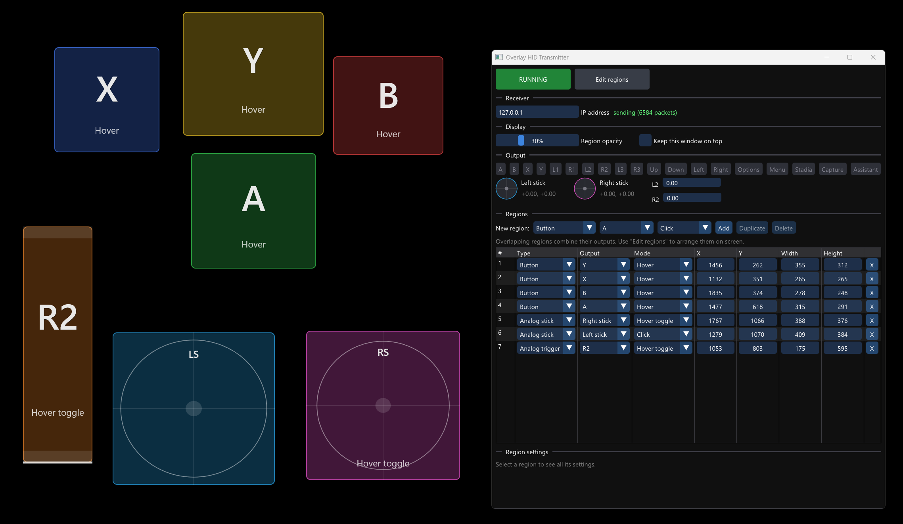

# Overlay HID Transmitter

This is a Windows application that lets you generate synthetic gamepad inputs by putting the mouse cursor in configurable translucent regions overlaid on top of your screen. Each region drives a button, an analog stick or an analog trigger of a simulated game controller.

It acts as the Transmitter component of a [HID Forwarder](https://github.com/jfedor2/hid-forwarder) setup. The gamepad inputs generated are sent to the configured Receiver. This way you can control a game on the same PC or on a separate computer or console.

It only uses mouse cursor position and left click so if you want to use it with some kind of a gaze tracking setup, configure it to control your mouse.

If you want to combine the inputs generated this way with inputs from other sources, like actual game controllers, take a look at the [HID Router](https://github.com/jfedor2/hid-router) project.

For downloads see the [latest release](https://github.com/jfedor2/overlay-hid-transmitter/releases/latest).

## Usage

- **RUNNING / STOPPED** button turns the overlay on and off. When stopped, the regions are hidden and the mouse is left alone.
- **Edit regions** puts the overlay in edit mode. Drag on empty screen space to draw a new region, drag a region to move it, drag its edges or corners to resize it. While editing, <kbd>Del</kbd> deletes the selected region and the arrow keys nudge it (<kbd>Shift</kbd> = 10 px). No inputs are sent while editing.
- **Receiver IP address**: the IP of the receiver. Inputs go to UDP port 42734.
- **Region opacity** and **Active opacity** are global settings: the fill of regions normally and while they're active (pressed).
- **Draw cursor** draws a mouse cursor on top of everything while running, for games that hide the cursor over their window. "When hidden" draws it only while the system cursor is hidden or fully transparent (as some apps do it); "Always" draws it all the time.
- **Block mouse movement from apps** keeps apps (games) from seeing the cursor move or hover over them while running, so they don't react to it, e.g. a menu changing the highlighted item while you navigate with a region-driven D-pad. An invisible window sits between the cursor and the apps; clicks outside regions still go through to the app below. It doesn't help with apps that read raw mouse input or poll the cursor position. The main window is left uncovered.
- **Output** shows the buttons and stick positions currently being sent.
- The region list shows each region's type, output, mode, position and size, all editable. The panel under it has the selected region's other settings.

Region types:

| Type           | Output |
|----------------|--------|
| Button         | A gamepad button. |
| Stick position | A fixed X/Y position of the left or right stick, over the whole region. |
| Analog stick   | The cursor's position in the region becomes the stick position. The center is neutral and the ellipse drawn in the region is full deflection (a round gate). Inner and outer deadzones are configurable per region. |
| Analog trigger | The cursor's position along the region becomes L2/R2 travel, horizontally (left = released) or vertically (bottom = released), optionally reversed. One deadzone applies to both ends: near the released end snaps to 0, near the other end to fully pressed. |

Region modes (all types support all modes):

| Mode         | Behavior |
|--------------|----------|
| Click        | Active while the left mouse button is held after clicking in the region. An analog stick or trigger keeps following the cursor while held, even outside the region (saturating at its edges). |
| Hover        | Active while the cursor is inside the region. No click needed, and the region doesn't block clicks. |
| Toggle       | A click latches the output (for an analog stick or trigger, the value where you clicked), the next click releases it. |
| Hover toggle | Like Hover, but a click latches the current output until the next click. |

Hover and Hover toggle regions can have a **hover delay**: the region only activates after the cursor has stayed inside it that long, and fills up from the bottom while waiting. For Hover toggle the delay applies to hovering only; clicks latch right away.

Regions can overlap: a click, or the cursor position, triggers every region under it, which is how you can do button combinations. Several regions driving the same stick add up (each axis capped at +/-1), so overlapping "up" and "right" regions give a diagonal. Trigger regions add up too (capped at full); an L2/R2 Button region counts as fully pressed. The digital L2/R2 bit is set past about 25% travel.

Minimizing the main window keeps the overlay active. Clicks on the main window itself are never captured, even if a region covers it.

Settings are saved automatically to `%APPDATA%\overlay-hid-transmitter\overlay-hid-transmitter\settings.json`.

Pass `--start` on the command line to start in the running state.

## Limitations

- If the game you want to control is on the same machine and uses the mouse, that may interfere with our screen overlay. If the game uses the mouse but doesn't need it, you can try the "Block mouse movement from apps" setting. If the game captures the mouse for itself, you can try alt-tabbing away from it so that it releases the mouse cursor. However most games won't read gamepad inputs when their window is not in focus, so you're probably out of luck anyway.
- Because of [UIPI](https://en.wikipedia.org/wiki/User_Interface_Privilege_Isolation), the mouse hook may not see clicks that go to elevated (administrator) windows. If that's a problem, run this as administrator too.
